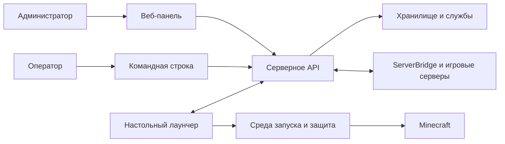

# NeverLauncher

> **Платформа для создания, управления и доставки Minecraft-клиентов.**  
> Единая система для владельца проекта, администратора, игрока и команды сопровождения — от настройки профиля до проверенного обновления клиента.

**Версия исходного кода:** [`1.0.0`](VERSION) · **Состояние выпуска:** кандидат на общедоступный выпуск; независимая приёмка ещё должна быть подтверждена · **Лицензия:** [Apache 2.0](LICENSE)

[Обзор продукта](docs/product/README.md) · [Возможности](docs/product/capabilities.md) · [Сценарии работы](docs/product/journeys.md) · [Что нового в 1.0.0](docs/releases/1.0.0.md) · [Документация](docs/README.md)

---

## Что такое NeverLauncher

NeverLauncher объединяет **серверное API**, **веб-панель управления**, **настольный лаунчер**, **инструменты командной строки**, **среду запуска Minecraft**, **защитные компоненты** и **интеграцию с игровыми серверами**.

Система помогает управлять конфигурацией клиента и его поставкой: проектами, профилями, версиями, файлами, манифестами, каналами обновлений и проверками целостности. Для эксплуатации предусмотрены средства развёртывания, диагностики, резервного копирования и контролируемого выпуска.

**Важно:** репозиторий содержит исходный код и процессы подготовки поставки. Это **не** готовый Minecraft-сервер, не дистрибутив игры и не доказательство сертификации на всех заявленных платформах.

## Возможности и компоненты

| Область | Что даёт | Где находится |
| :--- | :--- | :--- |
| **Управление проектами** | Профили, каналы, пакеты и рабочие области выпуска | `apps/admin/`, `services/api/` |
| **Приложение игрока** | Получение конфигураций, проверка файлов, скачивание и запуск | `apps/desktop/` |
| **Запуск и защита** | Java, загрузчики, целостность файлов и защитные политики | `runtime/` |
| **Игровая инфраструктура** | Интеграции серверов и прокси через ServerBridge | `plugins/`, `serverbridge/` |
| **Расширяемость** | Расширения, SDK и жизненный цикл модулей | `extensions/`, `sdk/` |
| **Эксплуатация** | Установка, диагностика, резервирование, обновление, выпуск | `cli/`, `scripts/`, `deploy/` |

[Подробнее о возможностях и ограничениях →](docs/product/capabilities.md)

## Как это связано



Схема показывает роли компонентов, а не полный перечень сетевых соединений или границ безопасности. Техническая детализация: [архитектура](ARCHITECTURE.md) и [модель доверия](docs/security/trust-model.md).

## С чего начать

| Вы хотите… | Откройте |
| :--- | :--- |
| Понять состав и назначение продукта | [Обзор и аудитории](docs/product/README.md) |
| Настроить клиент и пройти путь игрока | [Сценарии использования](docs/product/journeys.md) |
| Собрать исходный код | [Быстрый старт](docs/getting-started/quickstart.md) |
| Развернуть серверную часть | [Руководство оператора](docs/operator/installation.md) |
| Изучить HTTP-интеграции | [Справочник API](docs/reference/api.md) |
| Подготовить или проверить выпуск | [Релизный центр](docs/releases/README.md) |

### Минимальные проверки исходников

Из корневого каталога проекта:

```bash
python3 scripts/version/manage.py check
python3 scripts/contracts/validate-openapi.py
python3 scripts/compatibility/matrix.py validate --targets compatibility/targets.json
```

Для сборки компонентов нужны инструменты, указанные в [руководстве разработчика](DEVELOPMENT.md). Эти команды проверяют часть исходного дерева, но **не** устанавливают игру, не подписывают установщики и не заменяют реальное сквозное тестирование.

---

## Выпуск 1.0.0: что известно

**Релизная версия кода — 1.0.0.** В репозитории реализован механизм допуска к выпуску с привязкой к точному коммиту, проверкой подписанных артефактов и независимых свидетельств. Однако завершение этих проверок для конкретной поставки **нужно подтвердить отдельно**.

- **Целевые платформы проверки:** Windows, Linux и macOS — архитектуры x64 и ARM64.
- **Условия выпуска:** настоящие нативные пакеты, E2E-01–18, независимые подписи, обязательные проверки CI и отсутствие незакрытых блокирующих дефектов.
- **Правило:** отсутствующие или недействительные доказательства блокируют публикацию; зелёный контрактный тест не означает успешный запуск Minecraft.

[Описание выпуска 1.0.0](docs/releases/1.0.0.md) · [Порядок публикации](docs/releases/release-process.md) · [Контрольный список](docs/releases/release-checklist.md) · [История изменений](CHANGELOG.md)

## Сообщество и безопасность

Об ошибках сообщайте через [задачи GitHub](https://github.com/DeepLayerTeam/NeverLauncher/issues), предложения обсуждайте в [обсуждениях проекта](https://github.com/DeepLayerTeam/NeverLauncher/discussions), если они доступны. Перед публикацией диагностических данных удаляйте токены, ключи и персональные сведения.

Об уязвимостях сообщайте **непублично** согласно [политике безопасности](SECURITY.md). Разработчикам также пригодятся [правила участия](CONTRIBUTING.md) и [полная документация](docs/README.md).
