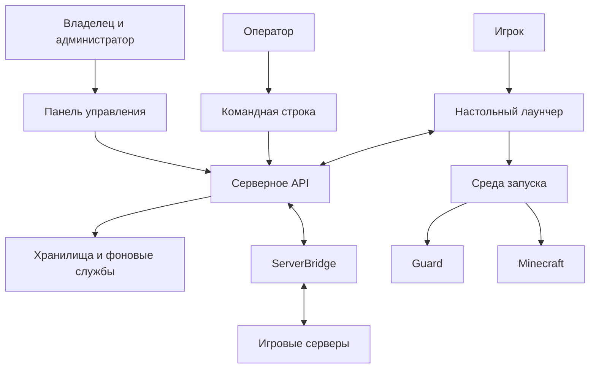

# NeverLauncher: обзор продукта

> **Управление клиентом Minecraft — от конфигурации до воспроизводимой поставки.** NeverLauncher связывает административные действия, серверное состояние, приложение игрока и контролируемый механизм выпуска.

[Возможности](capabilities.md) · [Сценарии использования](journeys.md) · [Состав проекта](../../README.md) · [Релизы](../releases/README.md)

---

## Для кого создана платформа

| Аудитория | Основная задача | Инструмент |
| :--- | :--- | :--- |
| **Владелец игрового проекта** | Управлять проектами, профилями, каналами и доступом | Веб-панель и серверное API |
| **Администратор** | Готовить пакеты, проверять изменения и контролировать публикацию | Рабочая область выпуска, API, CLI |
| **Игрок** | Получать актуальные файлы и запускать настроенный клиент | Настольное приложение |
| **Оператор инфраструктуры** | Развёртывать службы, восстанавливать состояние и проводить обновления | CLI, скрипты и документация оператора |
| **Разработчик интеграций** | Связывать платформу с игровыми серверами и модулями | ServerBridge, расширения, SDK |

## Принципы продукта

**Единая конфигурация.** Проект объединяет настройки клиента. Профиль описывает Minecraft, загрузчик и ресурсы, канал задаёт линию поставки, манифест фиксирует набор файлов и их контрольные суммы.

**Проверяемая доставка.** Клиент должен получать только допустимые артефакты, сверять подписи и контрольные суммы и восстанавливаться после сбоев загрузки в пределах реализованной политики.

**Разделение ролей.** Веб-панель, API, игровой клиент, среда выполнения и операторские средства выполняют разные функции и имеют разные границы доверия.

**Неизменяемость свидетельств.** Промышленный выпуск требует независимой проверки конкретного коммита и конкретных байтов. Заполненный отчёт без реального исполнения не считается подтверждением готовности.

## Из каких частей состоит NeverLauncher

Схема логическая: точные сетевые взаимодействия, протоколы и доверенные границы описаны в [архитектуре](../../ARCHITECTURE.md) и [модели доверия](../security/trust-model.md).

## Что входит в сферу продукта

- Создание и сопровождение **проектов, профилей, каналов и пакетов**.
- Работа с **манифестами, загрузкой и обновлением файлов**.
- **Запуск Minecraft** через отдельную среду выполнения и необходимые инструменты Java.
- **Аутентификация, разграничение прав и управление сессиями** в предусмотренных подсистемах.
- **Серверные интеграции и расширения**.
- **Проверка, подпись и выпуск** отдельных версий при выполнении обязательных условий.

Фактическая работоспособность каждой комбинации игры, загрузчика, ОС и поставки определяется испытаниями, а не самим наличием исходного кода. Подробная карта: [возможности и ограничения](capabilities.md).

## Что не следует предполагать

1. **Игра не поставляется в репозитории.** NeverLauncher не заменяет Minecraft и не предоставляет права на его использование.
2. **Номер версии не подтверждает готовую установку.** Для 1.0.0 необходима независимая приёмка и проверка финальных подписанных пакетов.
3. **Матрица совместимости — перечень целей, не сертификат.** Отдельные сочетания могут оставаться неподтверждёнными или недоступными в официальных источниках.
4. **Наличие отдельных API не доказывает готовый путь игрока.** В частности, проверяйте реальные интерфейсы, подтверждение владения Minecraft и выбор дополнительных модов для нужной версии.

## Продолжить чтение

[Первый пользовательский сценарий →](journeys.md)  
[Функциональная карта →](capabilities.md)  
[Документация оператора →](../operator/README.md)  
[Кандидат на выпуск 1.0.0 →](../releases/1.0.0.md)
