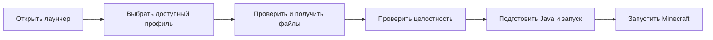

# Основные сценарии использования

> **Три маршрута — одна поставка.** Владелец подготавливает конфигурацию, игрок получает и запускает клиент, оператор обеспечивает сохранность и управляемое обновление инфраструктуры.

[Обзор](README.md) · [Возможности](capabilities.md) · [Релизы](../releases/README.md)

---

## 1. Владелец проекта: от идеи до пакета

1. **Развернуть серверную часть** в выбранном режиме и проверить доступность API, TLS и хранилищ.
2. **Создать административную учётную запись** штатным способом и проверить права.
3. **Создать проект и профиль**, указать Minecraft, загрузчик, Java и необходимые ресурсы.
4. **Настроить канал поставки**, подготовить файлы и сформировать манифест.
5. **Выполнить проверки целостности и реальный запуск** на требуемых целевых конфигурациях.
6. **Подготовить выпуск** через рабочую область Admin или допустимые операции CLI/API; опубликовать только при выполнении политики канала.

**Результат:** управляемый профиль с пакетом и подтверждёнными, где это требуется, условиями доставки. Само сохранение черновика не является публикацией.

[Подробности: установка](../operator/installation.md) · [Профили](../clients/profiles-and-launch.md) · [Рабочая область выпуска](../administration/release-workspace.md)

## 2. Игрок: от входа до Minecraft

Игрок использует доступный для его проекта способ аутентификации. Настольное приложение получает метаданные, сверяет файлы и передаёт запуск среде выполнения. **Успех игрового подключения зависит** от выбранного профиля, совместимых компонентов, действительных игровых прав и политики игрового сервера.

Для сценариев официального входа, расширенных модификаций и разных загрузчиков нужны отдельные E2E-подтверждения: [аутентификация](../authentication/providers.md), [профили](../clients/profiles-and-launch.md), [совместимость](../clients/compatibility.md).

## 3. Оператор: от установки до восстановления

1. **Подготовить окружение:** TLS, секреты, БД, хранилища, необходимые политики и права.
2. **Установить сервисы** согласно выбранному режиму и выполнить первичную проверку в реальной среде.
3. **Настроить резервное копирование** и подтвердить восстановление на изолированной копии.
4. **Проверить готовность обновления:** миграции, совместимость компонентов, откат и допустимый простой.
5. **Провести обновление**, проверить состояние API, доступ владельца, игровой запуск и целостность данных.
6. **При инциденте** использовать проверенную процедуру восстановления, не создавая одновременно два активных контура с одинаковыми ключами и узлами.

[Руководство оператора](../operator/README.md) · [Резервирование](../operator/backup-recovery.md) · [Обновления](../operator/upgrades.md)

## 4. Ответственный за выпуск: что должно быть доказано

Для версии `1.0.0` требуется подтвердить **E2E-01–18**, целевые платформы, окончательные подписанные установщики, отсутствие блокирующих дефектов и результат обязательных CI-заданий для одного и того же коммита. При отсутствии свидетельства выпуск остаётся заблокированным.

[Описание 1.0.0](../releases/1.0.0.md) · [Порядок выпуска](../releases/release-process.md) · [Контрольный список](../releases/release-checklist.md)

---

**Ограничение:** это продуктовая карта действий, а не автоматизированная инструкция, выполняющая эти шаги одной командой. Исполняемые команды, условия доступа и подтверждения берите из операторских и технических руководств по ссылкам.
