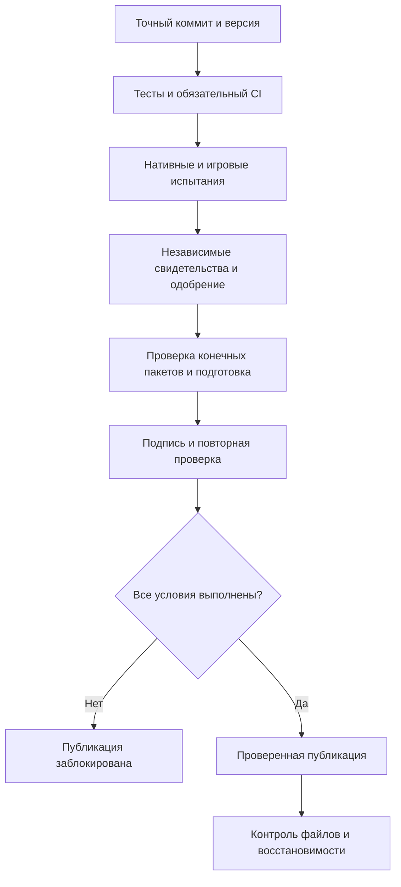

# Порядок подготовки и публикации релиза

> **Один коммит → проверяемые испытания → подписанные файлы → публикация.** Любой недоказанный обязательный этап останавливает выпуск.

[Релизный центр](README.md) · [Описание 1.0.0](1.0.0.md) · [Контрольный список](release-checklist.md)

---

## Последовательность



Диаграмма показывает зависимости. Она не заменяет защищённый рабочий процесс и не позволяет пропускать обязательные проверки.

## 1. Зафиксировать идентичность выпуска

- Сверьте номер версии с [`VERSION`](../../VERSION), модульными версиями и файлом истории изменений.
- Зафиксируйте **точный коммит**, а не только имя ветки или тег.
- Определите целевые ОС, архитектуры, профили и набор обязательных проверок; убедитесь, что исходное дерево соответствует утверждаемой поставке.

Первые проверки из корня репозитория:

```bash
python3 scripts/version/manage.py check
python3 scripts/contracts/validate-openapi.py
python3 scripts/compatibility/matrix.py validate --targets compatibility/targets.json
python3 scripts/device_trust/matrix.py validate --targets device-trust/targets.json
python3 scripts/guard_ci/matrix.py validate --targets guard-ci/targets.json
```

Успех этих команд подтверждает **только проверяемые ими условия**. Полный набор проверок и требования к инструментам описаны в [руководстве разработчика](../../DEVELOPMENT.md).

## 2. Исполнить обязательные проверки

Для `1.0.0` требуется реальная независимая приёмка **E2E-01–18**, необходимая матрица игровых комбинаций, шесть нативных установок и запусков, испытания безопасности, работоспособности и восстановления. Подробные доказательства и отчёты должны относиться к утверждённым пакету и коммиту.

Обязательны действительные результаты CI. Пропущенное, отменённое, просроченное или неуспешное задание нельзя считать положительным результатом, если оно входит в условия выпуска.

[Полная приёмка](../acceptance/full-real-user-ga.md) · [Матрица целевых платформ](../acceptance/supported-platform-ga-1.0.0.md)

## 3. Подготовить независимое одобрение

- Отдельный уполномоченный исполнитель формирует свидетельства и подписывает одобрение **в защищённом окружении**.
- Закрытые ключи и производственные токены не помещаются в репозиторий, архив исходников, публичные журналы или артефакты.
- Проверяющий механизм сверяет источник утверждения, точный коммит, хеши и полномочия подписанта с независимо закреплёнными значениями.

Для `1.0.0` нормативный формат и обязательные защищённые параметры описаны в [Supported Platform GA](../acceptance/supported-platform-ga-1.0.0.md). Не заменяйте реальные свидетельства созданными вручную отметками об успехе.

## 4. Сформировать и проверить поставку

Механизм `scripts/release/publication_ga.py` принимает **уже подготовленные финальные пакеты** и независимое одобрение. Операция `stage` проверяет входные данные и переносит пакеты в выпускаемый набор без перезаписи; при ошибке частичный перенос откатывается. Операция `verify` повторно подтверждает соответствие конечных файлов и свидетельств.

Затем механизмы подписи и проверки связывают обязательные ресурсы с `RELEASE_MANIFEST.json`, `SHA256SUMS` и подписью выпуска. Здесь не приводятся фиктивные значения ключей и путей: используйте параметры только из [точной процедуры 1.0.0](../acceptance/supported-platform-ga-1.0.0.md).

## 5. Опубликовать после заключительного допуска

Выпуск через `scripts/release/publish.py` должен повторно подтвердить готовность обязательного CI, независимую приёмку, подписанный состав и проверку публикации до обращения к GitHub с правом записи. Неполный или изменившийся набор означает **отказ**, а не ослабление политики.

После публикации ответственный оператор сверяет фактические доступные для скачивания байты, версии, контрольные суммы и инструкции установки. Отсутствие публичного выпуска не следует заменять ссылкой на исходный ZIP как на готовый установщик.

## 6. Обновление и восстановление

Релиз приложения и обновление действующей инфраструктуры — разные процессы. До развёртывания нужны проверенная резервная копия, план изменения БД и совместимости компонентов, проверка отката и исключение одновременной работы конфликтующих контуров.

[Обновление и откат](../operator/upgrades.md) · [Резервное копирование и восстановление](../operator/backup-recovery.md) · [Инциденты](../operator/ha-incidents.md)

---

## Условия немедленной блокировки

- Нет реального свидетельства для обязательного теста или платформы.
- Не совпадает коммит, версия, размер, подпись или SHA-256 конечного пакета.
- Истёк срок действия одобрения, отсутствуют независимые полномочия подписи либо свидетельство отозвано.
- Есть обязательная проверка CI со статусом ошибки, отмены или пропуска.
- Открыт блокирующий дефект P0/P1 либо проверка выполнялась на подменённой или неполной поставке.

**Нормативный источник:** [процедура допуска 1.0.0](../acceptance/supported-platform-ga-1.0.0.md) и [политика подписи](../operations/release-policy.md). При различии общего обзора и точных требований скрипта/политики применяйте строгую проверку точного коммита.
